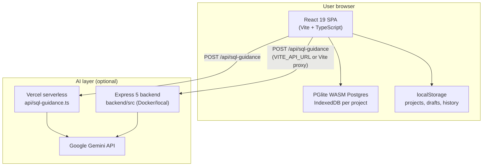
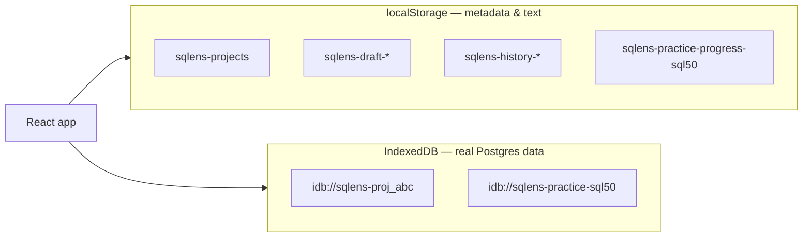

# SQLens — Implementation Documentation

> Comprehensive reference for **what** is implemented, **how** it works, and **which** tools and technologies power each layer.  
> Last aligned with the codebase structure as of June 2026.

---

## Table of contents

1. [Project purpose](#1-project-purpose)
2. [High-level architecture](#2-high-level-architecture)
3. [Repository layout](#3-repository-layout)
4. [Frontend](#4-frontend)
5. [In-browser database (no traditional backend for SQL)](#5-in-browser-database-no-traditional-backend-for-sql)
6. [Backend and AI API](#6-backend-and-ai-api)
7. [Vercel serverless API (`api/`)](#7-vercel-serverless-api-api)
8. [SQL execution simulator](#8-sql-execution-simulator)
9. [Entity Relationship Diagram (ERD)](#9-entity-relationship-diagram-erd)
10. [Practice hub and sample data](#10-practice-hub-and-sample-data)
11. [Onboarding tour](#11-onboarding-tour)
12. [Persistence and browser storage](#12-persistence-and-browser-storage)
13. [Build, dev, and deployment](#13-build-dev-and-deployment)
14. [Testing](#14-testing)
15. [Environment variables](#15-environment-variables)
16. [Related documentation](#16-related-documentation)

---

## 1. Project purpose

**SQLens** is a browser-native PostgreSQL playground for learning and experimenting with SQL. Users can:

- Run **real PostgreSQL** in the browser (no database server for query execution).
- Inspect schema, results, and an interactive **ERD** (inline workspace panel or fullscreen `/erd` view).
- Load **sample databases** and templates for fast practice.
- Work through the **LeetCode SQL 50** study plan at `/practice/sql50` (50 real LeetCode problems, auto-graded).
- Optionally use an **AI SQL assistant** that suggests concepts (not runnable SQL in the editor).
- **Simulate** `SELECT` query execution stage-by-stage with snapshots, diffs, and animated playback.

The product is intentionally **practice-first**: a tool, not a full course platform. All query data stays in the user’s browser unless they use the AI feature (which sends prompts and optional schema summaries to Google Gemini).

---

## 2. High-level architecture



| Concern | Where it runs | Technology |
|--------|----------------|------------|
| UI, editor, ERD, simulator UI | Browser | React 19, Vite 8, Tailwind CSS 4 |
| SQL execution & table data | Browser | PGlite → **IndexedDB** |
| Projects, drafts, history, SQL50 progress | Browser | **localStorage** |
| AI tutoring (main + SQL50 coach) | Server only | Express 5 **or** Vercel serverless → Gemini |

**No remote SQL server.** Queries never leave the browser. The backend only handles optional AI routes (`/api/sql-guidance`, `/api/sql50-coaching`).

### Data & backend at a glance

| What you create | Stored where | Survives refresh? | On a server? |
|-----------------|--------------|-------------------|--------------|
| Custom projects (names, list) | `localStorage` → `sqlens-projects` | Yes | No |
| SQL editor draft | `localStorage` → `sqlens-draft-{projectId}` | Yes | No |
| Query history (last 10) | `localStorage` → `sqlens-history-{projectId}` | Yes | No |
| Tables, rows, schema | IndexedDB → `idb://sqlens-{projectId}` | Yes | No |
| SQL50 bookmarks & progress | `localStorage` → `sqlens-practice-progress-sql50` | Yes | No |
| SQL50 draft per problem | Same progress key (`draftSql` field) | Yes | No |
| SQL50 submission SQL / results | **Not saved** (in-memory only) | No | No |
| Bundled sample DBs & SQL50 problems | Shipped in `src/data/` & `src/features/sql50/data/` (source code) | N/A | N/A |
| AI prompts + schema summary | Sent to Gemini when you use AI | No local persist | Yes (Google) |

**Clear Local Data** (ProjectSwitcher) wipes `localStorage` only. Old IndexedDB databases may remain as orphaned browser data until you clear site data in browser settings.

---

## 3. Repository layout

```
SQLens/
├── index.html                 # SPA shell, fonts, #app mount
├── package.json               # Frontend dependencies and scripts
├── vite.config.ts             # Vite + React + Tailwind; /api proxy; Vitest
├── vercel.json                # SPA rewrites; framework vite
├── netlify.toml               # Static build → dist; SPA redirect
├── docker-compose.yml         # frontend + backend services
├── Dockerfile                 # Frontend dev container (Node 20)
├── .env.example               # VITE_API_URL, VITE_API_PROXY_TARGET
│
├── src/                       # Entire React application (incl. pages/ErdFullscreenPage for /erd)
├── api/                       # Vercel serverless handlers (production AI + SQL50 coaching)
├── backend/                   # Standalone Express AI server (local/Docker)
└── Docs/                      # Project documentation
    ├── implementation.md      # This file
    ├── project-state.md         # Feature status and phased roadmap
    ├── gui-structure.md       # UI regions, components, design tokens
    └── deploy-ready.md        # Production hardening notes
```

---

## 4. Frontend

### 4.1 Role and responsibilities

The frontend is a **single-page application (SPA)** that:

1. Hosts the SQL editor, toolbar, results, simulator, ERD, and practice UI.
2. Owns all **client-side state** (active project, editor text, selection, query results, schema cache).
3. Initializes and talks to **PGlite** per project.
4. Calls **`/api/sql-guidance`** when the user opens the AI assistant (same-origin or via `VITE_API_URL`).
5. Persists non-database state in **localStorage** (projects, drafts, history, onboarding, simulator prefs).

Entry point: `src/main.tsx` → `StrictMode` → route switch:

- **`/`** (default) → `App.tsx` — full workspace
- **`/erd`** → `ErdFullscreenPage.tsx` — dedicated fullscreen ERD for one project (`?project={id}`)
- **`/practice/sql50`** → `Sql50PracticePage.tsx` — standalone SQL 50 practice platform (`?problem={slug}`)

### 4.2 Technology stack

| Technology | Version (package.json) | Role |
|------------|------------------------|------|
| **React** | ^19.2 | UI framework, hooks, `useTransition`, lazy loading for playback modal |
| **React DOM** | ^19.2 | Client rendering |
| **TypeScript** | ~6.0 | Type safety across app and shared API types |
| **Vite** | ^8.0 | Dev server, HMR, production build (`tsc && vite build`) |
| **@vitejs/plugin-react** | ^6.0 | JSX/TSX, Fast Refresh |
| **Tailwind CSS** | ^4.3 | Utility styling via `@tailwindcss/vite` |
| **CodeMirror** | `@uiw/react-codemirror` ^4.25, `@codemirror/lang-sql` ^6.10 | SQL editor, syntax highlighting, selection tracking, `Mod-Enter` run |
| **PGlite** | `@electric-sql/pglite` ^0.4.5 | In-browser PostgreSQL (WASM) |
| **React Flow** | `@xyflow/react` ^12.10 | ERD graph (nodes, edges, controls, minimap) |
| **Dagre** | `@dagrejs/dagre` ^3.0 | ERD automatic layout (ranked graph, connected components) |
| **html-to-image** | ^1.11.11 | ERD PNG/SVG export (pinned; newer versions have export bugs) |
| **jspdf** | ^4.2.1 | ERD PDF export (embeds captured PNG) |
| **node-sql-parser** | ^5.4.0 | Simulator: SQL → AST (PostgreSQL dialect) |
| **lucide-react** | ^1.16.0 | Icons |
| **clsx** | ^2.1.1 | Conditional classes (`cn` helper) |
| **react-hot-toast** | ^2.6.0 | Toast notifications (where used) |
| **@vercel/node** | ^5.3.0 | Types/dev alignment for serverless handlers in `api/` |

Fonts (Google Fonts in `index.html`): **Syne** (display), **Epilogue** (UI), **IBM Plex Mono** (SQL/data).

### 4.3 Application composition (`App.tsx`)

`App.tsx` wires the full workspace:

| Region | Components / hooks |
|--------|-------------------|
| Boot | `AppBootGate` + `useAppBootReady` — waits for PGlite ready, splash skeleton |
| Header | `AppHeader`, `PracticeRadialMenu`, `AiSqlGeneratorPopover`, tour restart |
| Sidebar | `WorkspaceLayout` + `ResizableSidebar` — `ProjectSwitcher`, `PracticeSidebar` (includes `SchemaSidebar`) |
| Main | `SqlEditor`, `ImportSqlButton`, `QueryToolbar`, `ErdScrollButton`, `LoadingBanner`, `StatusMessage`, `ResultTable`, `SimulatorPanel`, `QueryHistory`, `ErdViewer` (+ `ErdMaximizeButton` when `projectId` is set) |
| Fullscreen ERD | `ErdFullscreenPage` at `/erd?project={id}` — `ErdViewer` with `fullscreen`, schema refresh on tab focus |
| Overlay | `OnboardingTour` |

Central state hooks:

- **`useActiveProject`** — project list, active ID, `getDatabase(projectId)` PGlite instance.
- **`useSqlWorkspace(db, projectId)`** — query text, selection, run/reset, schema refresh, history, sample DB load, practice actions.
- **`useResizablePanel`** — sidebar width (desktop drag).
- **`useOnboardingTour`** — guided tour steps.

### 4.4 Source directory map

```
src/
├── App.tsx, main.tsx, index.css
├── pages/
│   ├── ErdFullscreenPage.tsx    # Standalone /erd route — fullscreen diagram for one project
│   └── Sql50PracticePage.tsx    # Standalone /practice/sql50 — LeetCode SQL 50 workspace
├── constants/
│   ├── layout.ts              # Sidebar min/max/default width
│   ├── practiceCategories.ts  # Practice hub category IDs and labels
│   ├── queries.ts             # DEFAULT_QUERY starter SQL
│   └── onboardingSteps.ts     # Tour step definitions
├── data/
│   ├── sampleDatabases.ts     # 4 bundled schemas + seed (Students, E-commerce, Library, HR)
│   ├── queryTemplates.ts      # 12 categorized example queries
│   ├── sqlSnippets.ts         # Short fragments for cursor insert
│   └── visualizationPresets.ts# Demo queries tied to sample DBs
├── hooks/
│   ├── useActiveProject.ts
│   ├── useSqlWorkspace.ts
│   ├── useQueryHistory.ts
│   ├── useResizablePanel.ts
│   ├── useAppBootReady.ts
│   ├── useOnboardingTour.ts
│   ├── useSimulatorPlayback.ts
│   └── useFlipAnimation.ts
├── lib/
│   ├── api/                   # AI client, schema formatting, SqlGuidance types
│   ├── db/                    # PGlite registry, runQuery, schema introspection
│   ├── erd/                   # Graph builder, dagre layout, designed text, export, fullscreen URL
│   ├── projects/              # Project CRUD + localStorage
│   ├── practice/              # Generic practice engine (grading, progress, scoring, URL sync)
│   ├── simulator/             # Parse → pipeline → snapshots → diffs
│   ├── sql/                   # assertSafeSql, simplifyError, splitSqlStatements, readSqlFile
│   ├── onboarding/            # Tour completion store
│   └── utils/                 # cn, viewTransition wrapper
└── components/
    ├── ai/                    # AiSqlGeneratorPopover
    ├── common/                # Button, Panel, StatusMessage, Skeleton, AnimatedReveal
    ├── editor/                # SqlEditor (CodeMirror ref API: insertAtCursor, onRun)
    ├── erd/                   # ErdViewer, ErdTableNode, ErdExportMenu, ErdMaximizeButton, DesignedTextModal
    ├── features/              # QueryToolbar, QueryHistory, ImportSqlButton
    ├── icons/                 # Brand and practice icons
    ├── layout/                # Header, workspace, boot gate, loading banner
    ├── onboarding/            # Tour overlay and step card
    ├── practice/              # Sidebar, radial menu, category content
    ├── projects/              # ProjectSwitcher
    ├── results/               # ResultTable
    ├── schema/                # SchemaSidebar, SchemaTableCard
    └── simulator/             # Panel, snapshot viewer, JOIN canvas, playback modal, debug
├── features/
│   └── sql50/                 # SQL 50 practice (layout, hooks, LeetCode dataset, modals)
│       ├── components/        # Sql50PageLayout, Sql50LeftSidebar, Sql50ActionBar, …
│       ├── data/sql50/
│       │   ├── leetcode50/    # Canonical 50 LeetCode problems (7 category files)
│       │   └── index.ts       # SQL50_PROBLEMS pack export
│       ├── hooks/             # useSql50, useSubmissionEngine, useSql50Simulation, …
│       └── services/          # progressStore, submissionEngine wrappers
```

Legacy `features/sql50/data/sql50/problems/` files may remain on disk but are **not** imported; the pack reads from `leetcode50/` only.

Main workspace entry: `AppHeader` promo slot → `Sql50HeaderButton` links to `/practice/sql50`.

### 4.5 Key user flows (frontend)

**Run query**

1. User edits SQL in `SqlEditor` or selects a fragment.
2. `Ctrl+Enter` / **Run Query** / **Run Selection** → `useSqlWorkspace.handleRunQuery`.
3. `runQuery(db, sql)` splits on semicolons (`splitSqlStatements`), executes each statement in order against PGlite; errors passed through `simplifySqlError`.
4. On success: `ResultTable` shows rows from the **last** statement that returned data; multi-statement runs get a combined success message; history append; `getSchema` refresh for sidebar + ERD.

**Switch project**

1. `ProjectSwitcher` → `switchProject(id)`.
2. `useSqlWorkspace` effect reloads draft, clears results, reloads history, re-inits schema from new `db` instance (`idb://sqlens-{projectId}`).

**Reset database**

- `resetDatabase(db)` — `DROP SCHEMA public CASCADE; CREATE SCHEMA public;` then schema refresh.

**AI guidance**

1. User opens **AI SQL** popover, enters natural-language goal.
2. `formatSchemaForAi(tables)` builds compact schema text.
3. `requestSqlGuidance(prompt, schema)` → `POST /api/sql-guidance`.
4. Response rendered as read-only cards (summary, breakdown, techniques, pitfalls). **No SQL is inserted into the editor.**

**Simulate query (main workspace)**

1. `SimulatorPanel` calls `generateSnapshots({ sql, db })` from `src/lib/simulator`.
2. On success: stage pills, diff-aware tables, optional JOIN canvas, debug panel, **Play Simulation** opens lazy-loaded `SimulatorPlaybackModal`.

**SQL 50 practice** — see [§10.3](#103-practice-sql-50-practicesql50).

### 4.6 UI primitives and styling

- Global theme: dark slate surfaces, blue accents (`src/index.css` CSS variables: `--color-surface`, `--color-line`, etc.).
- **`Panel`**, **`Button`**, **`StatusMessage`** — shared layout primitives.
- **View transitions**: `withViewTransition` wraps schema/result updates for smoother UI (where supported).
- **Responsive**: sidebar stacks on small screens; playback modal has mobile panel toggles.
- Detailed GUI map: [gui-structure.md](./gui-structure.md).

---

## 5. In-browser database (no traditional backend for SQL)

### 5.1 PGlite

| Aspect | Implementation |
|--------|----------------|
| Library | `@electric-sql/pglite` |
| Instance registry | `src/lib/db/createDatabase.ts` — `Map<projectId, PGlite>` |
| Storage URI | `idb://sqlens-{projectId}` (IndexedDB-backed persistence) |
| Legacy id | `"legacy"` can map to `idb://sqlens` for older single-DB users |

Each project gets an isolated database: schema, data, and simulator stage queries all use the same `db` for that project.

### 5.2 Query execution (`src/lib/db/query.ts`)

| Function | Behavior |
|----------|----------|
| `runQuery(db, sql)` | `splitSqlStatements(sql)` → sequential `db.query` per statement; stops on first error; returns last result set (or success message for DDL-only scripts) |
| `execSqlScript(db, sql)` | `db.exec(sql)` for multi-statement DDL/seed (sample DB load) |
| `resetDatabase(db)` | Drops and recreates `public` schema |

**Multi-statement execution:** `src/lib/sql/splitSqlStatements.ts` splits on `;` outside single-quoted strings, double-quoted identifiers, and `--` / `/* */` comments. Used by `runQuery` so users can paste several statements in the editor and run them in one action.

### 5.3 Schema introspection (`src/lib/db/schema.ts`)

`getSchema(db)` queries PostgreSQL **`information_schema`** (and related catalogs) to build `SchemaTable[]`:

- Columns: name, type, nullable, default
- Primary keys, foreign keys
- UNIQUE constraints (including composite)
- CHECK constraints (user-defined; system NOT NULL checks filtered)

Used by: schema sidebar, ERD graph, AI schema formatting, simulator (indirectly via same DB).

### 5.4 SQL safety helpers (`src/lib/sql/`)

- **`simplifyError.ts`** — Maps common PostgreSQL errors to short user-facing messages (FK violations, missing relation/column, syntax).
- **`splitSqlStatements.ts`** — Safe semicolon splitting for multi-statement editor runs (see §5.2).
- **`assertSafeSql.ts`** — Used for legacy/generated SQL paths; blocks destructive patterns when AI used to return SQL (deprecated path).

---

## 6. Backend and AI API

### 6.1 Purpose

The backend is **AI-only**. It does **not** store user data, run SQL, or sync projects.

| Backend does | Backend does **not** |
|--------------|----------------------|
| `POST /api/sql-guidance` — main workspace AI tutor | Execute or persist queries |
| `POST /api/sql50-coaching` — SQL50 problem-aware coach | Store bookmarks or submissions |
| Call Gemini, sanitize JSON responses | Host PostgreSQL |
| Rate-limit by IP | Sync across devices |

Flow: browser sends prompt (+ optional schema text) → server builds tutor prompt → Gemini → `sanitizeGuidance` → JSON cards back to UI. **No SQL is written into the editor.**

Legacy **`POST /api/generate-sql`** still exists; the UI uses guidance-only via `requestSqlGuidance`.

### 6.2 Technology stack (`backend/`)

| Technology | Version | Role |
|------------|---------|------|
| **Node.js** | 20 (Docker) | Runtime |
| **Express** | ^5.2.1 | HTTP server, JSON body, routing |
| **@google/generative-ai** | ^0.24.1 | Gemini SDK |
| **cors** | ^2.8.6 | Origin allowlist in production |
| **helmet** | ^8.1.0 | Security headers |
| **express-rate-limit** | ^8.1.0 | Per-IP rate limiting on `/api` |
| **dotenv** | ^17.4.2 | Load `backend/.env` |
| **axios** | ^1.16.1 | Used in Gemini service for some HTTP paths |
| **TypeScript** | ^6.0.3 | Compiled to `dist/` |
| **ts-node-dev** | dev | Hot reload for `npm run dev` |

### 6.3 Backend file map

```
backend/
├── package.json
├── Dockerfile                 # node:20-alpine, npm run build, node dist/index.js
├── .env.example
└── src/
    ├── index.ts               # Express app, CORS, helmet, health, mount /api + rate limit
    ├── routes/aiRoutes.ts     # POST /sql-guidance, /generate-sql, /sql50-coaching
    ├── services/gemini.ts     # resolveModelChain, generateWithGemini, quota/model errors
    ├── middleware/aiRateLimit.ts
    ├── prompts/
    │   ├── sqlGuidancePrompt.ts   # Active tutor prompt (main workspace)
    │   ├── sql50CoachingPrompt.ts # SQL 50 coach prompt
    │   └── sqlPrompt.ts           # Legacy SQL generation prompt
    └── utils/
        ├── sanitizeGuidance.ts
        └── sanitizeSql.ts
```

### 6.4 Server bootstrap (`backend/src/index.ts`)

- Port: `process.env.PORT` or **3001**
- **CORS**: In production, requires `ALLOWED_ORIGINS` (comma-separated); throws at startup if missing. Dev allows all origins.
- **Middleware**: `helmet`, `express.json({ limit: "16kb" })`, `trust proxy: 1`
- **Routes**: `GET /health` → `{ ok: true }`; `app.use("/api", aiRateLimit, aiRoutes)`
- Logs Gemini model chain on startup when `GEMINI_API_KEY` is set

### 6.5 AI routes (`backend/src/routes/aiRoutes.ts`)

| Route | Body | Response | Limits |
|-------|------|----------|--------|
| `POST /api/sql-guidance` | `prompt` (required), `schema` (optional string) | `{ guidance }` | prompt ≤ 2000 chars, schema ≤ 4000 chars |
| `POST /api/generate-sql` | `prompt` | `{ sql }` | prompt ≤ 2000 chars |
| `POST /api/sql50-coaching` | `problemTitle`, `problemDescription`, `userPrompt`, optional `schema`, `topics`, `unlockedHints`, `lastError` | `{ guidance }` | Problem-aware tutor for SQL 50; same sanitization as sql-guidance |

Error handling maps quota (429), model unavailable (503), validation (400), missing key (503), network (503/502) to JSON `{ error: string }`.

### 6.6 Gemini service (`backend/src/services/gemini.ts`)

- **Primary model**: `GEMINI_MODEL` or default `gemini-2.0-flash-lite`
- **Fallbacks**: `GEMINI_MODEL_FALLBACKS` or built-in list (`gemini-2.0-flash`, `gemini-2.5-flash-lite`, etc.)
- **`generateWithGemini(prompt, { jsonMode })`** — tries chain until success or throws `AiQuotaExceededError` / `AiModelUnavailableError`
- Requires **`GEMINI_API_KEY`** in environment

### 6.7 Guidance sanitization

`sanitizeGuidance` (backend + mirrored in `api/_lib/sanitizeGuidance.ts`):

- Parses JSON matching `SqlGuidance` shape
- Rejects output that looks like executable SQL (SELECT/INSERT/UPDATE/DELETE patterns, fenced SQL blocks)
- Surfaces `GUIDANCE_SQL_REJECTED_MESSAGE` to client as 400

### 6.8 Rate limiting

`backend/src/middleware/aiRateLimit.ts`:

- Env: `AI_RATE_LIMIT_WINDOW_MS` (default 60000), `AI_RATE_LIMIT_MAX` (default 15)
- Applied to all routes under `/api`

---

## 7. Vercel serverless API (`api/`)

For **production on Vercel**, the frontend static build is deployed with **serverless functions** alongside it—no separate Express container required.

| File | Route (Vercel) | Purpose |
|------|----------------|---------|
| `api/sql-guidance.ts` | `POST /api/sql-guidance` | Primary AI handler |
| `api/sql50-coaching.ts` | `POST /api/sql50-coaching` | SQL 50 problem-aware AI coach |
| `api/generate-sql.ts` | `POST /api/generate-sql` | Legacy SQL generation |
| `api/_lib/gemini.ts` | — | Shared Gemini client (parallel to backend service) |
| `api/_lib/buildSqlGuidancePrompt.ts` | — | Prompt builder (main workspace) |
| `api/_lib/buildSql50CoachingPrompt.ts` | — | Prompt builder (SQL 50 coach) |
| `api/_lib/sanitizeGuidance.ts` | — | Output validation |
| `api/_lib/rateLimit.ts` | — | IP rate limit for serverless |
| `api/_lib/sqlGuidanceTypes.ts` | — | Shared types |

`vercel.json` rewrites non-API, non-static paths to `/index.html` for SPA routing.

**Local dev:** Vite proxies `/api` → `VITE_API_PROXY_TARGET` (default `http://localhost:3001`) so the browser always calls same-origin `/api` while the Express backend can run separately.

---

## 8. SQL execution simulator

### 8.1 Purpose

Teach **how** a `SELECT` executes by:

1. Parsing SQL to an AST.
2. Building a **logical pipeline** of stages.
3. Generating **per-stage SQL**, executing each on PGlite.
4. Assigning **stable row IDs** and **diffs** between consecutive stages.
5. Rendering tables, JOIN canvas, and fullscreen **playback** with animations.

### 8.2 Engine layout (`src/lib/simulator/`)

```
simulator/
├── index.ts                    # Public barrel exports
├── types/
│   ├── simulatorTypes.ts       # Stage types, pipeline, result unions
│   └── snapshotTypes.ts        # TrackedRow, snapshots, StageDiff, RowDiff
├── sql/
│   ├── parseSql.ts             # Lazy node-sql-parser singleton, PostgreSQL dialect
│   ├── supportedSql.ts         # validateSqlSupport — rejects unsupported constructs
│   └── buildStageSql.ts        # AST → SQL per stage (incl. JOIN, GROUP BY, HAVING)
├── pipeline/
│   └── buildPipeline.ts        # AST → ordered SimulatorStage[]
└── snapshot/
    ├── generateSnapshots.ts    # Orchestrator: parse → validate → execute stages
    ├── assignRowIds.ts         # Content-based row identity across stages
    └── diffSnapshots.ts        # removed/added/reordered/null + reason strings
```

### 8.3 Pipeline order

Logical execution order:

`FROM` → `JOIN` → `WHERE` → `GROUP BY` → `HAVING` → `SELECT` → `ORDER BY` → `LIMIT`

### 8.4 Supported vs unsupported (simulator)

| Feature | Supported |
|---------|-----------|
| SELECT, FROM (single base table) | Yes |
| WHERE, ORDER BY, LIMIT | Yes |
| INNER JOIN, LEFT JOIN | Yes (+ JOIN canvas) |
| GROUP BY, HAVING | Yes |
| CTE (WITH) | No |
| UNION | No |
| Subqueries in FROM | No |
| Window functions | No |
| RIGHT / FULL / CROSS JOIN | No |
| Non-SELECT statements | No |

### 8.5 UI components (`src/components/simulator/`)

| Component | Role |
|-----------|------|
| `SimulatorPanel` | Entry: Simulate / Simulate Selection; hosts viewer, debug, playback trigger |
| `SimulatorSnapshotViewer` | Stage pills, active stage card, JOIN canvas hookup |
| `SimulatorSnapshotTable` | Diff-aware result table |
| `SimulatorJoinCanvas` | Static SVG row matching for JOIN stages |
| `SimulatorDebugPanel` | Tabs: SQL, row IDs, diffs |
| `playback/SimulatorPlaybackModal` | Fullscreen portal; keyboard shortcuts |
| `playback/*` | Transport, FLIP table, animated JOIN canvas, lesson panel, SQL context sidebar |

Hooks: **`useSimulatorPlayback`** (play/pause/speed/autoplay), **`useFlipAnimation`** (ORDER BY row reorder).

### 8.6 localStorage (simulator)

| Key | Purpose |
|-----|---------|
| `simulator:playbackSidebarWidth` | Playback sidebar width |
| `simulator:showRowIds` | Show row IDs in UI |
| `simulator:debug` | Enable debug logging when set to `"1"` |

---

## 9. Entity Relationship Diagram (ERD)

### 9.1 Overview

The ERD is a live React Flow graph built from `SchemaTable[]` (same `information_schema` data as the schema sidebar). It supports inline viewing in the workspace, a dedicated fullscreen route, export, and non-overlapping FK edge routing tuned for larger schemas (~20 tables).

### 9.2 File map

| Layer | File(s) | Role |
|-------|---------|------|
| Graph build | `src/lib/erd/buildErdGraph.ts` | `SchemaTable[]` → React Flow `Node[]` / `Edge[]`; FK edges carry `ErdEdgeData` (`sourceColumn`, `targetColumn`); delegates layout |
| Layout & routing | `src/lib/erd/layoutErdGraph.ts` | Dagre auto-layout, connected-component placement, column-aligned handles, per-handle lane offsets |
| Custom node | `src/components/erd/ErdTableNode.tsx` | Table header, column rows (PK/FK/UQ badges), per-column handles on all four sides |
| Canvas | `src/components/erd/ErdViewer.tsx` | Background, Controls, MiniMap, `fitView` on schema change; `fullscreen` prop for height |
| Fullscreen entry | `src/components/erd/ErdMaximizeButton.tsx` | Opens `/erd?project={id}` in a new tab |
| Fullscreen page | `src/pages/ErdFullscreenPage.tsx` | Standalone `/erd` route; loads project DB, refreshes schema on tab focus |
| Fullscreen URL | `src/lib/erd/erdFullscreenUrl.ts` | `buildErdFullscreenUrl`, `resolveErdProjectId` |
| Export menu | `src/components/erd/ErdExportMenu.tsx` | PNG, SVG, PDF, Designed Text |
| Capture | `src/lib/erd/export/captureErdViewport.ts` | `html-to-image` + React Flow bounds |
| PDF | `src/lib/erd/export/exportErdPdf.ts` | `jspdf` |
| Designed text | `src/lib/erd/buildDesignedText.ts` | ASCII schema for LLM paste |
| Modal | `src/components/erd/DesignedTextModal.tsx` | Copy entire text |

### 9.3 Graph build pipeline

```
getSchema(db) → SchemaTable[]
  → buildErdGraph(tables)
      1. One erdTable node per table (id = table_name)
      2. One smoothstep edge per FK (deduped by table.column → ref.column)
      3. layoutErdGraph(nodes, edges)
  → ErdViewer renders nodes + edges
```

**Node sizing:** fixed width `NODE_WIDTH` (248px); height from column count (`HEADER_H` + `ROW_H` × columns + padding).

### 9.4 Layout (`layoutErdGraph.ts`)

Uses **`@dagrejs/dagre`** with `rankdir: "TB"` (top-to-bottom). Referenced tables are ranked **above** referencing tables (parent above child). Spacing (`nodesep`, `ranksep`, margins) **scales with table count** so larger schemas get more room.

Disconnected FK subgraphs are laid out separately and placed **side by side** with a component gap (`COMPONENT_GAP`).

### 9.5 Edge routing (non-overlapping lines)

Designed to stay readable with many tables and hub-and-spoke FK patterns:

1. **Column-aligned handles** — Each FK edge connects at the FK column row on the source table and the referenced column row on the target (`source-{side}-col-{name}` / `target-{side}-col-{name}`). Side (`top` / `right` / `bottom` / `left`) is chosen from relative node positions.
2. **Per-handle lane offsets** — Edges sharing the same source handle or target handle are spread with `pathOptions.offset` on React Flow `smoothstep` edges. Lane spacing tightens slightly when many edges share one handle.
3. **Parallel FKs** — Multiple FK columns between the same two tables use distinct column handles and lane offsets.

`ErdTableNode` renders invisible fallback center handles for compatibility; routing prefers column handles.

### 9.6 Fullscreen route

| Piece | Behavior |
|-------|----------|
| Route | `/erd` or `/erd/` (pathname check in `main.tsx`; SPA rewrite via `vercel.json`) |
| Query | `?project={projectId}` — falls back to active project or default project |
| Open | `ErdMaximizeButton` on inline canvas (top-left panel) → `window.open` |
| Refresh | `ErdFullscreenPage` re-fetches schema when the tab becomes visible again |

### 9.7 Export

Visual exports (PNG / SVG / PDF) capture the current viewport via `html-to-image`, excluding controls and minimap. **Designed Text** opens a modal with structured ASCII schema for pasting into AI chat.

Data source: `workspace.tables` in the main app; `getSchema(db)` on the fullscreen page.

---

## 10. Practice hub and sample data

### 10.1 Categories (`src/constants/practiceCategories.ts`)

Practice hub sections (sidebar + header radial menu):

- Sample databases
- Query templates
- SQL snippets (insert at CodeMirror cursor via `SqlEditor` ref)
- Visualization presets

### 10.2 Data files

| File | Content |
|------|---------|
| `sampleDatabases.ts` | 4 schemas: Students, E-commerce, Library, HR — DDL + INSERT + optional starter query |
| `queryTemplates.ts` | 12 example queries (JOINs, GROUP BY, subqueries, NULL, etc.) |
| `sqlSnippets.ts` | Short clause fragments |
| `visualizationPresets.ts` | Pairs preset queries with sample DB ids |

Loading a sample DB: `execSqlScript` → refresh schema → optionally set editor from `starterQuery`.

### 10.3 Practice SQL 50 (`/practice/sql50`)

Standalone LeetCode-style workspace — does **not** modify the main project workspace. Entry from **`Sql50HeaderButton`** in `AppHeader` or direct URL with optional `?problem={slug}`.

#### Architecture

| Layer | Location | Role |
|-------|----------|------|
| Page | `src/pages/Sql50PracticePage.tsx` | Orchestrates layout, modals, keyboard shortcuts |
| Feature module | `src/features/sql50/` | UI, hooks, progress, LeetCode dataset |
| Generic engine | `src/lib/practice/` | Shared types, result-set grading, progress store, scoring, URL sync |
| Dedicated DB | `getDatabase("practice-sql50")` | Isolated PGlite (`idb://sqlens-practice-sql50`) |
| AI coach | `POST /api/sql50-coaching` | Tutor-only coaching via `AiCoachPanel` + `sanitizeGuidance` |

#### Problem dataset (LeetCode SQL 50)

All **50 official LeetCode SQL 50 study-plan problems** in order, PostgreSQL-adapted for PGlite:

| File under `leetcode50/` | Category | Count |
|--------------------------|----------|-------|
| `select.ts` | Select | 5 |
| `basic-joins.ts` | Basic Joins | 9 |
| `basic-aggregate.ts` | Basic Aggregate Functions | 8 |
| `sorting.ts` | Sorting and Grouping | 7 |
| `advanced-select.ts` | Advanced Select and Joins | 7 |
| `subqueries.ts` | Subqueries | 7 |
| `advanced-string.ts` | Advanced String / Regex / Clause | 7 |

Each `PracticeProblem` (`src/lib/practice/types.ts`) includes:

- `id` (1–50 study-plan order), `leetcodeId` (LeetCode problem number), `slug`, `title`, `difficulty`, `topics`
- `description` — one-line summary shown in the workbench
- `statement` — full LeetCode-style text (schema, examples, constraints) for the problem modal
- `schemaSql`, `seedSql`, `expectedOutputSql` (with `ORDER BY` for deterministic grading)
- `hints` (3), `explanation`, `officialSolution`

Exported as `SQL50_PROBLEMS` from `src/features/sql50/data/sql50/index.ts`.

#### Page layout (desktop)

Three-column **`h-dvh`** shell via `Sql50PageLayout` + `AppBootGate className="h-dvh"`:

```
Header (title, progress, back to workspace)
├── Left 260px — Sql50LeftSidebar
│   └── Tabs: Problems | Schema (one full-height scroll region per tab)
├── Center flex-1 — Sql50Workbench
│   ├── Problem strip (ProblemHeader: LeetCode #, difficulty, title, nav, bookmark)
│   ├── Short description + link to full statement
│   ├── Sql50EditorPanel (~240px, titleless SqlEditor)
│   ├── Sql50ActionBar (Play Simulation · Run · Submit · Reset DB)
│   └── Sql50ResultsPanel (min 30vh, always visible)
└── Right 280px — Progress, Hints, Reveal Solution, AI Coach
```

**Mobile (`< lg`):** center workbench full width; sticky bottom tab bar **Problems | Schema | Help**.

There is **no inline simulator panel** on this page. **Play Simulation** (enabled after a successful run) calls `generateSnapshots` via `useSql50Simulation` and opens fullscreen `SimulatorPlaybackModal` through `Sql50SimulationModal`.

#### Key components

| Component | Role |
|-----------|------|
| `Sql50LeftSidebar` | Problems/Schema tabs; embeds `ProblemSidebar` + `SchemaSidebar` |
| `ProblemSidebar` | Search, difficulty pills, favorites, collapsible topic filter |
| `ProblemStatementModal` | Full LeetCode statement; portal to `document.body`, dismissible (×, Close, Escape, backdrop) |
| `SolutionModal` | Official solution + visualize |
| `Sql50ActionBar` | Action hierarchy: secondary Play Sim → primary Run → secondary Submit → ghost Reset |
| `Sql50ResultsPanel` | Labeled results region with `ResultTable` empty state |
| `SubmissionResultPanel` | Wrong answer / accepted feedback |
| `ProgressPanel`, `HintPanel`, `AiCoachPanel` | Right sidebar help |

#### Hooks

| Hook | Role |
|------|------|
| `useSql50` | Active problem, query draft, run/reset, schema, URL slug sync |
| `useSubmissionEngine` | Submit vs expected output; scoring on accept |
| `useProblemProgress` | localStorage progress, bookmarks, analytics |
| `useSql50Simulation` | Snapshot generation + modal state for playback |

#### Grading and scoring

- **Never compares SQL strings.** Runs user query and `expectedOutputSql`, compares columns / row count / cell values via `compareResultSets` (order-insensitive multiset; column names case-insensitive).
- **Score** (`computeScore`): penalizes hints used, failed attempts, viewing solution before solve.
- **Submit** vs **Run Query**: Run shows results only; Submit grades against expected output.

#### Progress storage

Bookmarks, drafts, solved state, and scores live in `localStorage` (keys in [§12.3](#123-localstorage-keys)). Submission SQL is not persisted — see [§12.4](#124-sql50--what-is-and-is-not-saved).

#### Keyboard shortcuts

| Shortcut | Action |
|----------|--------|
| `Ctrl+Enter` | Run query |
| `Ctrl+Shift+Enter` | Submit |
| `[` / `]` | Previous / next problem |
| `Ctrl+b` | Toggle bookmark |

#### Generic practice engine (`src/lib/practice/`)

Reusable for future problem packs:

| Module | Role |
|--------|------|
| `types.ts` | `PracticeProblem`, progress, submission types |
| `compareResultSets.ts` | Result-set equality for grading |
| `submissionEngine.ts` | `gradeSubmission(db, userSql, expectedSql)` |
| `problemLoader.ts` | Reset DB, apply schema + seed per problem |
| `progressStore.ts` | Pack-scoped localStorage CRUD |
| `scoring.ts` | Best-score computation |
| `practiceUrl.ts` | `?problem=` slug sync |

---

## 11. Onboarding tour

| Piece | Location |
|-------|----------|
| Steps | `src/constants/onboardingSteps.ts` |
| State | `src/lib/onboarding/onboardingStore.ts` (completion flag in localStorage) |
| Hook | `src/hooks/useOnboardingTour.ts` |
| UI | `OnboardingTour`, `OnboardingStepCard`, `OnboardingSpotlightOverlay` |

Tour targets DOM regions via `dataTour` attributes (e.g. ERD panel `dataTour="erd-section"`). Restart from header help control.

---

## 12. Persistence and browser storage

All user data stays in the **browser** (this machine + this browser profile). There is no account system and no cloud database.

### 12.1 Two storage layers



| Layer | Technology | Holds |
|-------|------------|-------|
| **IndexedDB** | PGlite (`idb://…`) | Actual tables, columns, rows — everything `CREATE TABLE` / `INSERT` creates |
| **localStorage** | Plain JSON strings | Project list, editor drafts, query history, SQL50 progress, UI prefs |

Schema sidebar and ERD read live from IndexedDB (`information_schema`). They are not cached separately.

### 12.2 IndexedDB databases

| URI | Used by | Contents |
|-----|---------|----------|
| `idb://sqlens-{projectId}` | Main workspace (`createDatabase.ts`) | One isolated Postgres DB per custom project |
| `idb://sqlens-practice-sql50` | `/practice/sql50` | Problem schema + seed data, reset per problem load |
| `idb://sqlens` | Legacy single-DB users | Preserved under project id `"legacy"` |

Implementation: [`src/lib/db/createDatabase.ts`](../src/lib/db/createDatabase.ts).

### 12.3 localStorage keys

| Key | Contents | Module |
|-----|----------|--------|
| `sqlens-projects` | Project list (`id`, `name`, dates) | `projectStore.ts` |
| `sqlens-active-project` | Active project id | `projectStore.ts` |
| `sqlens-draft-{projectId}` | Main editor SQL buffer | `projectStore.ts` |
| `sqlens-history-{projectId}` | Last **10** executed queries | `useQueryHistory.ts` |
| `sqlens-practice-progress-{packId}` | Per-problem: solved, attempts, hints, **bookmark**, best score, **draftSql** | `progressStore.ts` |
| `sqlens-practice-active-{packId}` | Last opened problem slug | `progressStore.ts` |
| `sqlens-onboarding-complete` | Tour finished flag | `onboardingStore.ts` |
| `simulator:*` | Playback sidebar width, row IDs, debug flag | See §8.6 |
| Layout keys | Sidebar / panel widths | `useResizablePanel.ts`, layout constants |

### 12.4 SQL50 — what is and is not saved

| Saved in localStorage | Not saved |
|-----------------------|-----------|
| Bookmark per problem | Past submission SQL |
| Solved / attempts / best score | Last submit verdict after refresh |
| Hints used, solution viewed flag | |
| Draft SQL per problem (`draftSql`) | |

Grading runs in the browser (`submissionEngine.ts` + PGlite). Submit updates progress counters only.

### 12.5 Import SQL (main workspace)

**Import SQL** toolbar button → [`ImportSqlButton`](../src/components/features/ImportSqlButton.tsx) reads a local `.sql` / `.txt` file ([`readSqlFile.ts`](../src/lib/sql/readSqlFile.ts), max 1 MB) into the editor. Content is persisted via the normal draft auto-save. Imported SQL is **not** auto-run.

### 12.6 Clearing data

**ProjectSwitcher → Clear Local Data** calls `clearAllLocalData()` in [`projectStore.ts`](../src/lib/projects/projectStore.ts): removes all keys above (projects, drafts, history, SQL50 progress, onboarding, simulator prefs), then reloads.

Does **not** delete IndexedDB PGlite files. Orphaned DB blobs may remain until cleared via browser site-data settings.

---

## 13. Build, dev, and deployment

### 13.1 Frontend scripts (`package.json`)

| Script | Command | Output / behavior |
|--------|---------|-------------------|
| `dev` | `vite` | http://localhost:5173, proxies `/api` |
| `build` | `tsc && vite build` | `dist/` |
| `preview` | `vite preview` | Local preview of production build |
| `test` | `vitest run` | Unit tests |
| `test:ui` | `vitest --ui` | Vitest UI |

### 13.2 Deployment targets

| Target | Config | AI |
|--------|--------|-----|
| **Vercel** | `vercel.json`, framework vite, `api/` functions | Same project; set `GEMINI_API_KEY` etc. |
| **Netlify** | `netlify.toml` — build `dist`, SPA redirect | Needs separate AI host or Netlify functions (not in repo); typically `VITE_API_URL` to Vercel API |
| **Docker Compose** | `docker-compose.yml` | Frontend :5173, backend :3001, `VITE_API_PROXY_TARGET=http://backend:3001` |
| **Static only** | `npm run build` | SQL works; AI disabled without API |

### 13.3 Docker services

| Service | Image / build | Port | Command |
|---------|---------------|------|---------|
| `frontend` | Root `Dockerfile` | 5173 | `npm install && npm run dev -- --host 0.0.0.0` |
| `backend` | `backend/Dockerfile` | 3001 | `node dist/index.js` after `npm run build` |

Frontend volume-mounts repo; `node_modules` anonymous volume. Backend reads `backend/.env`.

---

## 14. Testing

**Runner:** Vitest 4 (`vite.config.ts` — `environment: "node"`).

| Test file | Area |
|-----------|------|
| `src/lib/simulator/__tests__/simulator.test.ts` | Simulator pipeline, snapshots, diffs |
| `src/lib/erd/__tests__/buildDesignedText.test.ts` | Designed text export |
| `src/lib/erd/__tests__/layoutErdGraph.test.ts` | Dagre layout, column handles, lane offsets, large star-schema routing |
| `src/lib/db/__tests__/schema.test.ts` | Schema introspection helpers |
| `src/lib/db/__tests__/query.test.ts` | Multi-statement `runQuery` behavior |
| `src/lib/sql/__tests__/splitSqlStatements.test.ts` | SQL semicolon splitting (strings, comments) |
| `src/lib/sql/__tests__/readSqlFile.test.ts` | SQL file import validation and reading |
| `src/lib/onboarding/__tests__/onboardingStore.test.ts` | Onboarding persistence |
| `src/constants/__tests__/onboardingSteps.test.ts` | Tour step config |
| `src/lib/practice/__tests__/compareResultSets.test.ts` | Practice result-set comparison |
| `src/lib/practice/__tests__/scoring.test.ts` | Practice score computation |
| `src/features/sql50/data/__tests__/manifest.test.ts` | SQL50 pack manifest (50 problems, unique ids/slugs/leetcodeIds) |
| `src/features/sql50/data/__tests__/sql-validation.test.ts` | PGlite validation of all 50 problems (schema, seed, official solution) |
| `src/components/simulator/playback/join/__tests__/joinPlaybackModel.test.ts` | JOIN playback model |
| `api/_lib/__tests__/sanitizeGuidance.test.ts` | Guidance sanitization (serverless lib) |

Run: `npm test` (Vitest; includes simulator, ERD, practice engine, and full SQL50 PGlite validation suite).

---

## 15. Environment variables

### 15.1 Frontend (`.env` / Vercel / Netlify)

| Variable | Purpose |
|----------|---------|
| `VITE_API_URL` | Optional API base (e.g. `http://localhost:3001`). Empty = same-origin `/api` |
| `VITE_API_PROXY_TARGET` | Dev/Docker only: Vite proxy target for `/api` (default `http://localhost:3001`) |

**Never** put `GEMINI_API_KEY` in `VITE_*` variables.

### 15.2 Backend (`backend/.env`)

| Variable | Purpose |
|----------|---------|
| `GEMINI_API_KEY` | Required for AI |
| `GEMINI_MODEL` | Primary Gemini model |
| `GEMINI_MODEL_FALLBACKS` | Comma-separated fallback models |
| `ALLOWED_ORIGINS` | Production CORS allowlist |
| `AI_RATE_LIMIT_WINDOW_MS` | Rate limit window (ms) |
| `AI_RATE_LIMIT_MAX` | Max requests per IP per window |
| `PORT` | Server port (default 3001) |
| `NODE_ENV` | `production` enforces CORS allowlist |

### 15.3 Vercel serverless (project env)

Same Gemini and rate-limit variables as backend; used by `api/sql-guidance.ts` and `api/_lib/rateLimit.ts`.

---

## 16. Related documentation

| Document | Focus |
|----------|--------|
| [project-state.md](./project-state.md) | Phased roadmap, shipped features, file-level phase notes |
| [gui-structure.md](./gui-structure.md) | Visual layout, components, colors, interactions |
| [deploy-ready.md](./deploy-ready.md) | Production security, CORS, rate limits, data cleanup |
| [README.md](../README.md) | Quick start, features list, keyboard shortcuts |

---

## Summary table: who implements what

| Capability | Storage / runtime | Backend involved? |
|------------|-------------------|-------------------|
| SQL editor, run, reset | PGlite → IndexedDB | No |
| Import SQL file | Editor draft → localStorage | No |
| Custom projects | localStorage + IndexedDB per project | No |
| Schema sidebar & ERD | Live read from IndexedDB | No |
| Query history & drafts | localStorage | No |
| SQL50 progress & bookmarks | localStorage | No |
| SQL50 table data | IndexedDB `practice-sql50` | No |
| SQL50 submit grading | PGlite in browser | No |
| Practice samples & problem defs | Bundled TypeScript source | No |
| Simulator | PGlite + `node-sql-parser` | No |
| Main workspace AI tutor | — | Yes → `/api/sql-guidance` → Gemini |
| SQL50 AI coach | — | Yes → `/api/sql50-coaching` → Gemini |

**Thick client** for all SQL work; **thin optional API** for AI only. No remote Postgres, no user database on the server.
